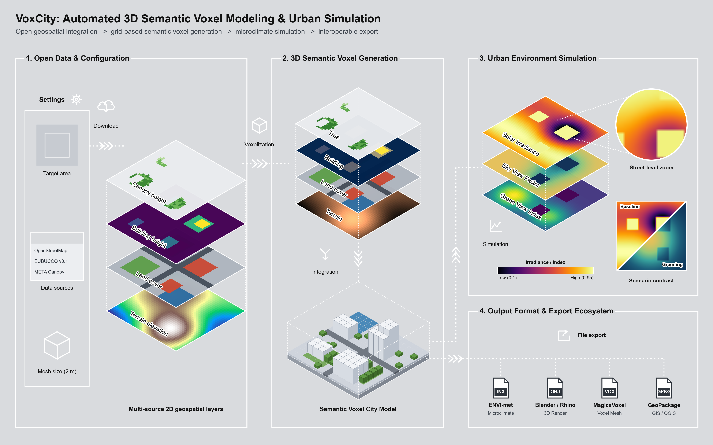
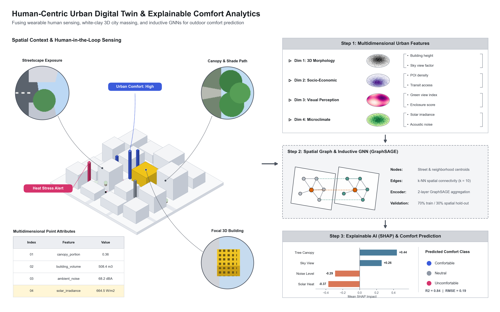
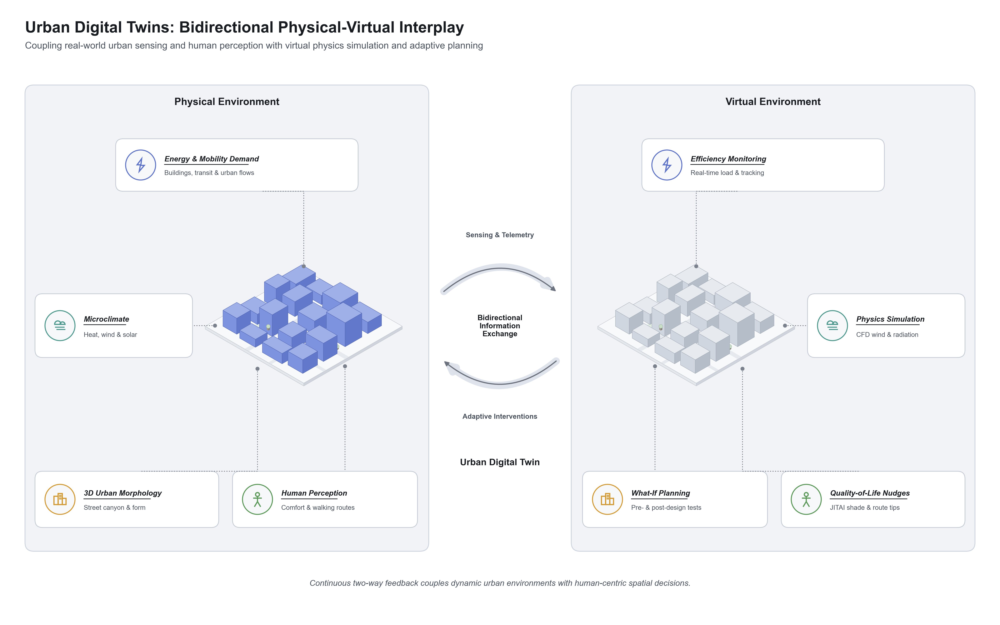
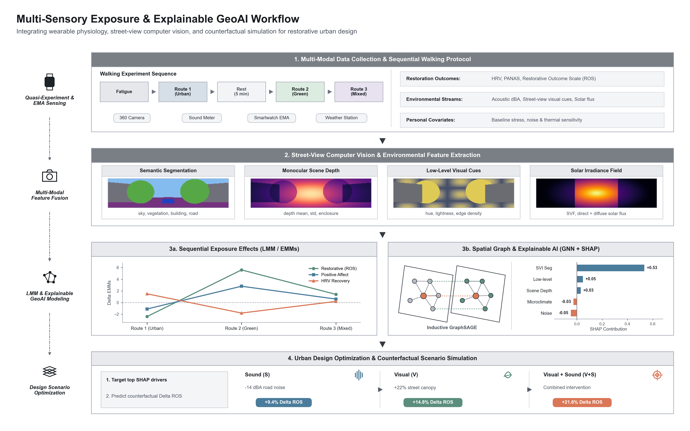

# paper-graphical-abstract

A scientific **Graphical Abstract & Figure 1 Architecture Skill** distilled from Dr. Binyu Lei and the NUS Urban Analytics Lab (*VoxCity*, *Urban Comfort Index*, *Human-Centric Digital Twins*, *Outdoor Comfort JITAIs*, and *GeoAI/GNN* workflows).

Exports **300 DPI PNG + editable vector SVG** (`svg.fonttype = 'none'`, editable directly in Adobe Illustrator, Figma, or Inkscape).

---

## Four Visual Archetypes (Showcases)

| Archetype | Style Anchor | Ground & Signature Elements | Runnable Script & Outputs |
| :--- | :--- | :--- | :--- |
| **A — Studio Grey Exploded Spatial Pipeline** | *VoxCity* (*CEUS* 2026) | Matte `#D9DBDE`, 90° notched `#FFFFFF` frames, 30° isometric exploded stacks with `-30°` halo labels, `>>>` dotted orthogonal flows, folded file badges | [Script](.agents/skills/paper-graphical-abstract/examples/demo_studio_grey_voxcity.py) · [PNG](.agents/skills/paper-graphical-abstract/examples/output/demo_archetype_a_studio_grey.png) · [SVG](.agents/skills/paper-graphical-abstract/examples/output/demo_archetype_a_studio_grey.svg) |
| **B — Editorial White Clay-3D + Loupes & Method Column** | *Human-Centric DT* (*SCS* 2023), *Urban Comfort* (*SCS* 2025), *JITAIs* (*Cities* 2026) | Crisp `#FFFFFF`, white-clay 3D massing with single focal accents, circular photo loupes, right-hand modular Step 1–4 stack, `[ ... ]` feature brackets, tilted GNN planes | [Script](.agents/skills/paper-graphical-abstract/examples/demo_editorial_clay_geoai.py) · [PNG](.agents/skills/paper-graphical-abstract/examples/output/demo_archetype_b_editorial_clay.png) · [SVG](.agents/skills/paper-graphical-abstract/examples/output/demo_archetype_b_editorial_clay.svg) |
| **C — Isometric Conceptual Interplay & Twin Mirror** | *Urban Comfort GA* (*SCS* 2025), *UDT Twin* (*Cities* 2026), *AutCon* (2023) | Symmetric Physical↔Virtual twin dioramas, translucent curved exchange arcs, L-shaped dotted leaders, underlined italic callouts | [Script](.agents/skills/paper-graphical-abstract/examples/demo_interplay_twin.py) · [PNG](.agents/skills/paper-graphical-abstract/examples/output/demo_archetype_c_interplay_twin.png) · [SVG](.agents/skills/paper-graphical-abstract/examples/output/demo_archetype_c_interplay_twin.svg) |
| **D — Multi-Stage Spine / S-Flow Matrix** | *Walking Green & Grey* (*B&E* 2026), *Cycling Safety* (*CEUS* 2026) | Left icon-spine + 4-tier matrix embedding street-view CV slices, tilted GNN planes, and real SHAP/EMM mini-charts | [Script](.agents/skills/paper-graphical-abstract/examples/demo_geoai_matrix.py) · [PNG](.agents/skills/paper-graphical-abstract/examples/output/demo_archetype_d_geoai_matrix.png) · [SVG](.agents/skills/paper-graphical-abstract/examples/output/demo_archetype_d_geoai_matrix.svg) |

### Archetype Previews

| **Archetype A — Studio Grey Pipeline** | **Archetype B — Editorial Clay-3D + Loupes** |
| :---: | :---: |
|  |  |
| **Archetype C — Twin Mirror Interplay** | **Archetype D — Multi-Stage GeoAI Matrix** |
|  |  |

---

## How to Use in Antigravity, T3 Code, and Codex

All platforms read the exact same self-contained folder: **`.agents/skills/paper-graphical-abstract/`**.  
Python dependencies required when rendering figures: `matplotlib`, `numpy`, and `pillow`.

### 1. Antigravity (IDE / CLI / ACP)

Antigravity automatically discovers skills from workspace `.agents/skills/` or global `~/.gemini/config/skills/`:

- **Option 1 — Project-local (zero setup when working inside this repo)**:  
  Already active at `.agents/skills/paper-graphical-abstract/`. For another paper repo, copy `.agents/skills/paper-graphical-abstract/` into that repo's `.agents/skills/`.
- **Option 2 — Machine-global (available in every project)**:
  - **Windows (PowerShell)**:
    ```powershell
    New-Item -ItemType Directory -Force "$env:USERPROFILE\.gemini\config\skills" | Out-Null
    Copy-Item -Recurse -Force ".\.agents\skills\paper-graphical-abstract" "$env:USERPROFILE\.gemini\config\skills\paper-graphical-abstract"
    ```
  - **macOS / Linux (Bash)**:
    ```bash
    mkdir -p ~/.gemini/config/skills
    cp -r .agents/skills/paper-graphical-abstract ~/.gemini/config/skills/
    ```
- **Option 3 — Register via `~/.gemini/config/skills.json` (auto-updates on `git pull`)**:
  ```json
  {
    "entries": [
      { "path": "/ABSOLUTE/PATH/TO/paper-figure/.agents/skills" }
    ]
  }
  ```
- **How to invoke**: Just describe your paper & preferred archetype in chat (e.g., *"Use paper-graphical-abstract (Archetype B) to draw Figure 1 for my paper..."*); Antigravity loads `SKILL.md` automatically via progressive disclosure.

### 2. Codex (OpenAI Codex CLI / IDE / App)

Codex reads global skills from `~/.codex/skills/` (or `$CODEX_HOME/skills/`) and also ships UI metadata in `agents/openai.yaml`:

- **Install globally**:
  - **Windows (PowerShell)**:
    ```powershell
    $codexHome = if ($env:CODEX_HOME) { $env:CODEX_HOME } else { "$env:USERPROFILE\.codex" }
    New-Item -ItemType Directory -Force "$codexHome\skills" | Out-Null
    Copy-Item -Recurse -Force ".\.agents\skills\paper-graphical-abstract" "$codexHome\skills\paper-graphical-abstract"
    ```
  - **macOS / Linux (Bash)**:
    ```bash
    mkdir -p "${CODEX_HOME:-$HOME/.codex}/skills"
    cp -r .agents/skills/paper-graphical-abstract "${CODEX_HOME:-$HOME/.codex}/skills/"
    ```
- **How to invoke**: Mention **`$paper-graphical-abstract`** explicitly in your prompt (recommended) or describe a Graphical Abstract / Figure 1 task and let Codex auto-select it.

### 3. T3 Code

T3 Code delegates execution to whichever agent provider your thread uses (**Antigravity**, **Codex**, or **Claude Code**):

1. **Per-repository (works automatically for any provider)**:  
   Copy `.agents/skills/paper-graphical-abstract/` into the `.agents/skills/` folder of the paper repository you open in T3 Code.
2. **Global across all T3 Code threads** (install into the active provider's global skill folder):
   - **If your T3 thread runs Antigravity**: install to `~/.gemini/config/skills/paper-graphical-abstract/` (see Section 1).
   - **If your T3 thread runs Codex**: install to `~/.codex/skills/paper-graphical-abstract/` (see Section 2).
   - **If your T3 thread runs Claude Code**: install to `~/.claude/skills/paper-graphical-abstract/`:
     ```powershell
     # Windows PowerShell
     New-Item -ItemType Directory -Force "$env:USERPROFILE\.claude\skills" | Out-Null
     Copy-Item -Recurse -Force ".\.agents\skills\paper-graphical-abstract" "$env:USERPROFILE\.claude\skills\paper-graphical-abstract"
     ```
     ```bash
     # macOS / Linux
     mkdir -p ~/.claude/skills && cp -r .agents/skills/paper-graphical-abstract ~/.claude/skills/
     ```

### Example Prompts You Can Paste Directly

- **Archetype A (Software / Simulation Pipeline)**:
  > *"Use `paper-graphical-abstract` (Archetype A: Studio Grey) to generate our Graphical Abstract (PNG + SVG). Title: 'CityThermal: Open-Source Urban Microclimate Simulator'. Module 1: OSM + DEM + Sentinel-2 -> Module 2: 3D voxelization -> Module 3: solar radiation & MRT simulation -> Module 4: .GPKG, .INX, .OBJ export."*
- **Archetype B (GeoAI / 3D City + Real Assets)**:
  > *"Use `$paper-graphical-abstract` (Archetype B: Editorial White Clay-3D) to build Figure 1. Composite my transparent 3D campus render `assets/campus_clay.png` and street photos `assets/svi_*.jpg` into circular loupes on the left, and arrange Step 1 Feature Discs -> Step 2 Inductive GraphSAGE -> Step 3 SHAP Feature Importance on the right. Export PNG + SVG."*
- **Archetype C / D (Conceptual Twin or Empirical Matrix)**:
  > *"Read `paper-graphical-abstract` and design Figure 1 using Archetype C (Physical-Virtual Digital Twin mirror) [or Archetype D Multi-Stage Matrix], following the attached manuscript abstract. Audit with `audit_figure.py` and show me the rendered PNG."*

---

## Repository Structure

- [`.agents/skills/paper-graphical-abstract/SKILL.md`](.agents/skills/paper-graphical-abstract/SKILL.md) — Skill entrypoint & 6-stage production workflow.
- [`.agents/skills/paper-graphical-abstract/agents/openai.yaml`](.agents/skills/paper-graphical-abstract/agents/openai.yaml) — Codex UI display & invocation policy metadata.
- [`.agents/skills/paper-graphical-abstract/references/`](.agents/skills/paper-graphical-abstract/references/) — Empirical visual catalog (15 UAL papers), design tokens, PyVista/Blender/QGIS hybrid asset guide, prompt template, and QA checklist.
- [`.agents/skills/paper-graphical-abstract/scripts/ual_ga_kit.py`](.agents/skills/paper-graphical-abstract/scripts/ual_ga_kit.py) — Pure Matplotlib + NumPy + PIL isometric & architectural drawing engine.
- [`.agents/skills/paper-graphical-abstract/scripts/audit_figure.py`](.agents/skills/paper-graphical-abstract/scripts/audit_figure.py) — Automated PNG margin, saturation restraint, and SVG editable-text validator.
- [`.agents/skills/paper-graphical-abstract/examples/`](.agents/skills/paper-graphical-abstract/examples/) — Runnable scripts generating 300 DPI PNG + editable SVG outputs for Archetypes A, B, C, and D.
