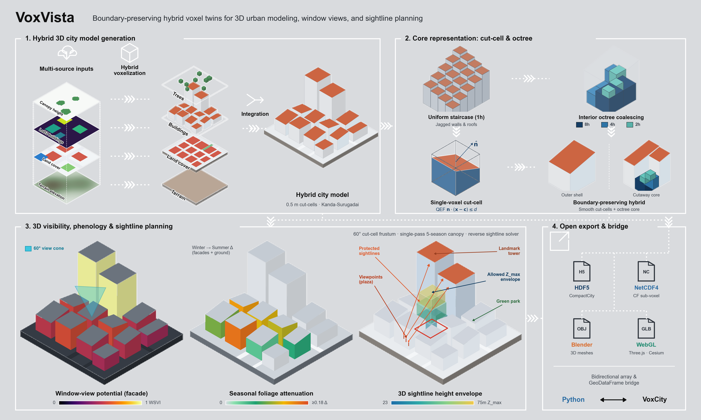

# paper-graphical-abstract

A scientific **Graphical Abstract & Figure 1 Architecture Skill** distilled from Dr. Binyu Lei and the NUS Urban Analytics Lab (*VoxCity*, *VoxVista*, *Urban Comfort Index*, *Human-Centric Digital Twins*, *Outdoor Comfort JITAIs*, and *GeoAI/GNN* workflows).

Exports **240–300 DPI PNG + vector PDF & editable SVG** (`svg.fonttype = 'none'`, `pdf.fonttype = 42`).

---

## Flagship Preset: Architectural Studio Editorial (`editorial_studio.py`)

Built on the *VoxVista* (*CEUS* v6/v5) studio standard with decoupled **Stage-A transparent asset caching & 3D→2D `[u, v]` anchor projection** and **Stage-B normalized composition**:

- **Studio Grey Canvas (`#D9DBDE`)** with inline header (`23.5 pt Bold` + same-line `12.2 pt` subtitle) and 90° notched `#FFFFFF` section frames (`1.6 pt`).
- **Context Desaturation**: Architectural clay (`#E2E4E7` / `#D5DFE6` / `#CC6542`), discrete blue-teal hierarchy (`#153D64 → #2E74A6 → #58B0A8`), darkened `#353B44` terrain behind `inferno` heatmaps, and noise-suppressed Delta ramps (`#D5DBE1`).
- **Top-Most `ann_ax` (`zorder=30`) + Physical-Aspect-Corrected Chevrons**: Horizontal/vertical `>>>` arrows match pixel-for-pixel, `crop_stack_alpha_union` aligns exploded 3D stacks, and `add_anchored_callout` eliminates manual 3D leader guesswork.
- **Showcase**: [Script](.agents/skills/paper-graphical-abstract/examples/demo_editorial_studio.py) · [PNG](.agents/skills/paper-graphical-abstract/examples/output/demo_editorial_studio.png) · [PDF](.agents/skills/paper-graphical-abstract/examples/output/demo_editorial_studio.pdf) · [SVG](.agents/skills/paper-graphical-abstract/examples/output/demo_editorial_studio.svg)



---

## Four Core Visual Archetypes (`ual_ga_kit.py`)

| Archetype | Style Anchor | Ground & Signature Elements | Runnable Script & Outputs |
| :--- | :--- | :--- | :--- |
| **A — Studio Grey Exploded Spatial Pipeline** | *VoxCity* (*CEUS* 2026) | Matte `#D9DBDE`, 90° notched `#FFFFFF` frames, 30° isometric exploded stacks with `-30°` halo labels, `>>>` dotted orthogonal flows, folded file badges | [Script](.agents/skills/paper-graphical-abstract/examples/demo_studio_grey_voxcity.py) · [PNG](.agents/skills/paper-graphical-abstract/examples/output/demo_archetype_a_studio_grey.png) · [SVG](.agents/skills/paper-graphical-abstract/examples/output/demo_archetype_a_studio_grey.svg) |
| **B — Editorial White Clay-3D + Loupes & Method Column** | *Human-Centric DT* (*SCS* 2023), *Urban Comfort* (*SCS* 2025), *JITAIs* (*Cities* 2026) | Crisp `#FFFFFF`, white-clay 3D massing with single focal accents, circular photo loupes, right-hand modular Step 1–4 stack, `[ ... ]` feature brackets, tilted GNN planes | [Script](.agents/skills/paper-graphical-abstract/examples/demo_editorial_clay_geoai.py) · [PNG](.agents/skills/paper-graphical-abstract/examples/output/demo_archetype_b_editorial_clay.png) · [SVG](.agents/skills/paper-graphical-abstract/examples/output/demo_archetype_b_editorial_clay.svg) |
| **C — Isometric Conceptual Interplay & Twin Mirror** | *Urban Comfort GA* (*SCS* 2025), *UDT Twin* (*Cities* 2026), *AutCon* (2023) | Symmetric Physical↔Virtual twin dioramas, translucent curved exchange arcs, L-shaped dotted leaders, underlined italic callouts | [Script](.agents/skills/paper-graphical-abstract/examples/demo_interplay_twin.py) · [PNG](.agents/skills/paper-graphical-abstract/examples/output/demo_archetype_c_interplay_twin.png) · [SVG](.agents/skills/paper-graphical-abstract/examples/output/demo_archetype_c_interplay_twin.svg) |
| **D — Multi-Stage Spine / S-Flow Matrix** | *Walking Green & Grey* (*B&E* 2026), *Cycling Safety* (*CEUS* 2026) | Left icon-spine + 4-tier matrix embedding street-view CV slices, tilted GNN planes, and real SHAP/EMM mini-charts | [Script](.agents/skills/paper-graphical-abstract/examples/demo_geoai_matrix.py) · [PNG](.agents/skills/paper-graphical-abstract/examples/output/demo_archetype_d_geoai_matrix.png) · [SVG](.agents/skills/paper-graphical-abstract/examples/output/demo_archetype_d_geoai_matrix.svg) |

### Archetype Previews

| **Archetype A — Studio Grey Pipeline** | **Archetype B — Editorial Clay-3D + Loupes** |
| :---: | :---: |
|  |  |
| **Archetype C — Twin Mirror Interplay** | **Archetype D — Multi-Stage GeoAI Matrix** |
|  |  |

---

## How to Use in Antigravity, T3 Code, and Codex

All platforms read the exact same self-contained folder: **`.agents/skills/paper-graphical-abstract/`**.  
Python dependencies required when rendering figures: `matplotlib`, `numpy`, and `pillow` (optional `pymupdf` for PDF font auditing, optional `pyvista` for VTK 3D off-screen renders).

### 1. Antigravity (IDE / CLI / ACP)

Antigravity automatically discovers skills from workspace `.agents/skills/` or global `~/.gemini/config/skills/`:

- **Option 1 — Project-local (zero setup inside this repo)**:  
  Already active at `.agents/skills/paper-graphical-abstract/`. For another paper repo, copy `.agents/skills/paper-graphical-abstract/` into that repo's `.agents/skills/`.
- **Option 2 — Machine-global (available in every project)**:
  - **Windows (PowerShell)**:
    ```powershell
    New-Item -ItemType Directory -Force "$env:USERPROFILE\.gemini\config\skills" | Out-Null
    Copy-Item -Recurse -Force ".\.agents\skills\paper-graphical-abstract" "$env:USERPROFILE\.gemini\config\skills\paper-graphical-abstract"
    ```
  - **macOS / Linux (Bash)**:
    ```bash
    mkdir -p ~/.gemini/config/skills
    cp -r .agents/skills/paper-graphical-abstract ~/.gemini/config/skills/
    ```
- **Option 3 — Register via `~/.gemini/config/skills.json` (auto-updates on `git pull`)**:
  ```json
  {
    "entries": [
      { "path": "/ABSOLUTE/PATH/TO/paper-figure/.agents/skills" }
    ]
  }
  ```

### 2. Codex (OpenAI Codex CLI / IDE / App)

Codex reads global skills from `~/.codex/skills/` (or `$CODEX_HOME/skills/`) and ships UI metadata in `agents/openai.yaml`:

- **Install globally**:
  - **Windows (PowerShell)**:
    ```powershell
    $codexHome = if ($env:CODEX_HOME) { $env:CODEX_HOME } else { "$env:USERPROFILE\.codex" }
    New-Item -ItemType Directory -Force "$codexHome\skills" | Out-Null
    Copy-Item -Recurse -Force ".\.agents\skills\paper-graphical-abstract" "$codexHome\skills\paper-graphical-abstract"
    ```
  - **macOS / Linux (Bash)**:
    ```bash
    mkdir -p "${CODEX_HOME:-$HOME/.codex}/skills"
    cp -r .agents/skills/paper-graphical-abstract "${CODEX_HOME:-$HOME/.codex}/skills/"
    ```
- **How to invoke**: Mention **`$paper-graphical-abstract`** explicitly in your prompt or describe a Graphical Abstract / Figure 1 task.

### 3. T3 Code

T3 Code delegates execution to whichever agent provider your thread uses (**Antigravity**, **Codex**, or **Claude Code**):

1. **Per-repository**: Copy `.agents/skills/paper-graphical-abstract/` into the `.agents/skills/` folder of the paper repository you open in T3 Code.
2. **Global across all T3 Code threads**: Install into your active provider's global folder (`~/.gemini/config/skills/` for Antigravity, `~/.codex/skills/` for Codex, or `~/.claude/skills/` for Claude Code).

### Automated QA Verification

```bash
python .agents/skills/paper-graphical-abstract/scripts/audit_figure.py <out.png> --svg <out.svg> --pdf <out.pdf> --theme editorial_studio
```

---

## Repository Structure

- [`.agents/skills/paper-graphical-abstract/SKILL.md`](.agents/skills/paper-graphical-abstract/SKILL.md) — Skill entrypoint & two-stage workflow.
- [`.agents/skills/paper-graphical-abstract/agents/openai.yaml`](.agents/skills/paper-graphical-abstract/agents/openai.yaml) — Codex UI display & invocation policy metadata.
- [`.agents/skills/paper-graphical-abstract/references/`](.agents/skills/paper-graphical-abstract/references/) — `editorial_studio_style.md` (VoxVista Studio Editorial spec), empirical UAL catalog, archetype tokens, hybrid asset guide, and QA checklist.
- [`.agents/skills/paper-graphical-abstract/scripts/editorial_studio.py`](.agents/skills/paper-graphical-abstract/scripts/editorial_studio.py) — Architectural Studio Editorial engine (Stage-A caching, alpha-union, `[u, v]` anchors, top-most `ann_ax`).
- [`.agents/skills/paper-graphical-abstract/scripts/ual_ga_kit.py`](.agents/skills/paper-graphical-abstract/scripts/ual_ga_kit.py) — Inch-canvas isometric & vector drawing kit for Archetypes A–D.
- [`.agents/skills/paper-graphical-abstract/scripts/audit_figure.py`](.agents/skills/paper-graphical-abstract/scripts/audit_figure.py) — Automated PNG + SVG + PDF quality validator.
- [`.agents/skills/paper-graphical-abstract/examples/`](.agents/skills/paper-graphical-abstract/examples/) — Runnable scripts generating flagship Architectural Studio Editorial + Archetypes A–D showcases.
